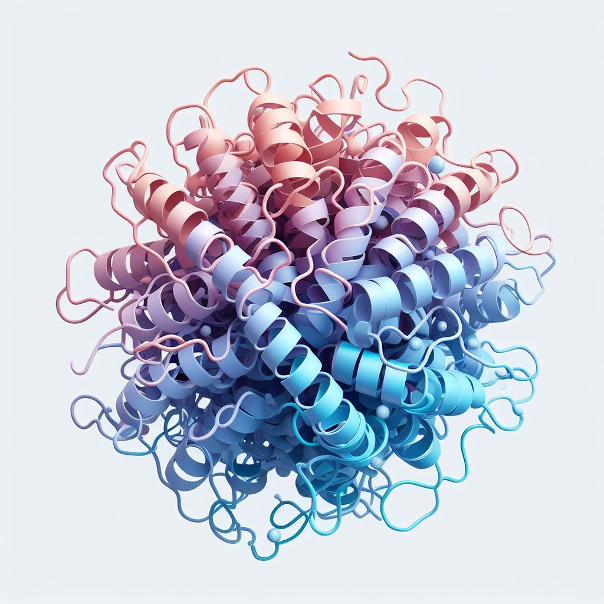

<!-- Improved compatibility of back to top link: See: https://github.com/othneildrew/Best-README-Template/pull/73 -->
<a name="readme-top"></a>
<!--
*** Thanks for checking out the Best-README-Template. If you have a suggestion
*** that would make this better, please fork the repo and create a pull request
*** or simply open an issue with the tag "enhancement".
*** Don't forget to give the project a star!
*** Thanks again! Now go create something AMAZING! :D
-->


<!-- PROJECT SHIELDS -->
<!--
*** I'm using markdown "reference style" links for readability.
*** Reference links are enclosed in brackets [ ] instead of parentheses ( ).
*** See the bottom of this document for the declaration of the reference variables
*** for contributors-url, forks-url, etc. This is an optional, concise syntax you may use.
*** https://www.markdownguide.org/basic-syntax/#reference-style-links
-->


<!-- PROJECT LOGO -->
<br />
<div align="center">
  <a href="https://github.com/naity/finetune-esm">
    
  </a>
 
<h3 align="center">Finetune-ESM</h3>

  <p align="center">
    Protein-protein binding-affinity regression with protein language models, using cached embeddings for fast iteration on a single GPU.
    <br />
    <br />
    <br />
    <a href="https://github.com/naity/finetune-esm/issues">Report Bug</a>
    ·
    <a href="https://github.com/naity/finetune-esm/issues">Request Feature</a>
  </p>
</div>


<!-- TABLE OF CONTENTS -->
<details>
  <summary>Table of Contents</summary>
  <ol>
    <li>
      <a href="#about-the-project">About The Project</a>
      <ul>
        <li><a href="#built-with">Built With</a></li>
      </ul>
    </li>
    <li>
      <a href="#getting-started">Getting Started</a>
      <ul>
        <li><a href="#prerequisites">Prerequisites</a></li>
      </ul>
    </li>
    <li><a href="#usage">Usage</a></li>
    <li><a href="#roadmap">Roadmap</a></li>
    <li><a href="#contributing">Contributing</a></li>
    <li><a href="#license">License</a></li>
    <li><a href="#contact">Contact</a></li>
    <li><a href="#acknowledgments">Acknowledgments</a></li>
  </ol>
</details>


<!-- ABOUT THE PROJECT -->
## About The Project

This project fine-tunes protein language models (starting with ESM-2) for **protein-protein
binding-affinity regression**: given a ligand and receptor sequence, predict pKd
(−log₁₀ of the dissociation constant KD, in M). It trains and evaluates on
[`proteinea/ppb_affinity`](https://huggingface.co/datasets/proteinea/ppb_affinity)
(CC-BY-NC-SA-4.0), a benchmark of 8,207 protein complexes drawn primarily from SKEMPI v2.0
and PDBbind v2020.

**Highlights**

* **Screening-tier training on cached embeddings**: the backbone is frozen and its
  per-residue embeddings are cached once, so the full harness (cache build + a 3-seed
  training sweep) runs in about **15 minutes on one RTX 3090**.
* **Reproducible, tracked experiments**: per-epoch metrics are logged to MLflow, and
  checkpoints are written to a run-specific directory (backbone/fusion/split/seed), so
  runs never collide or overwrite each other.
* **A measured baseline, not just numbers picked to look good**: see
  [Reproduction result](#reproduction-result) below.

For the full design rationale — dataset statistics, why the screening/LoRA two-tier
design, the experiment plan, and what was deliberately deferred — see
[`docs/superpowers/specs/2026-08-30-ppb-affinity-design.md`](docs/superpowers/specs/2026-08-30-ppb-affinity-design.md).

<p align="right">(<a href="#readme-top">back to top</a>)</p>


### Built With

* [![Python][Python_badge]][Python-url]
* [![Pytorch][Pytorch_badge]][Pytorch-url]
* [![ESM][ESM_badge]][ESM-url]
* [![Lightning][Lightning_badge]][Lightning-url]
* [![MLflow][MLflow_badge]][MLflow-url]
* [![Transformers][Transformers_badge]][Transformers-url]

<p align="right">(<a href="#readme-top">back to top</a>)</p>


<!-- GETTING STARTED -->
## Getting Started

1. Clone the repo:
```sh
git clone https://github.com/naity/finetune-esm.git
```

2. Install dependencies with [uv](https://docs.astral.sh/uv/):
```sh
uv sync --extra dev
```

### Prerequisites

* Python >= 3.11
* A CUDA GPU is strongly recommended for building the embedding cache (`build-cache`);
  training against a built cache is fast enough to run on CPU for small experiments.

<p align="right">(<a href="#readme-top">back to top</a>)</p>


<!-- USAGE EXAMPLES -->
## Usage

The CLI has two commands: build the embedding cache once per backbone, then train (fast,
repeatable) against that cache.

```sh
# 1. Encode every unique chain in the dataset once and cache the embeddings.
uv run python -m finetune_esm.train build-cache --backbone esm2-650m --device cuda --batch-size 8

# 2. Train one configuration against the cache (repeat per seed/fusion/split as needed).
uv run python -m finetune_esm.train train \
  --backbone esm2-650m --fusion hp --split author --seed 0 \
  --num-epochs 30 --batch-size 32 --learning-rate 1e-3
```

Run `uv run python -m finetune_esm.train train --help` for the full set of options,
including `--loss-name`, `--dropout`, `--patience`, and `--accelerator`.

Training logs per-epoch metrics to a local MLflow store under `results/mlflow/`. View it with:

```sh
uv run mlflow ui --backend-store-uri results/mlflow
```

### Reproduction result

The harness was gated on reproducing the benchmark paper's ESM2-650M + HP (frozen) result
before any further experimentation. Full commands, logs, and analysis are in
[`results/e0_reproduction.md`](results/e0_reproduction.md); the headline numbers:

| Source | Spearman | Pearson | RMSE |
|---|---|---|---|
| **This harness (mean ± sd, 3 seeds, MLP head)** | **0.4284 ± 0.0029** | 0.4178 ± 0.0041 | 1.6045 ± 0.0242 |
| Published: ESM2-650M + HP, frozen + ConvBERT head | 0.47 | 0.48 | 1.74 |
| This project's trivial-feature floor (sequence length/composition, no PLM) | 0.229 | 0.226 | 1.896 |

The reproduction was accepted as a gate pass (within the ±0.05 acceptance band and nearly
double the trivial-feature floor), with the residual gap to the published number most
plausibly attributed to the head architecture (this harness uses a plain MLP head; the
published run used ConvBERT). See `results/e0_reproduction.md` for the full gate verdict
and follow-on diagnostics.

<p align="right">(<a href="#readme-top">back to top</a>)</p>


<!-- ROADMAP -->
## Roadmap

- [x] Dataset loading and caching for protein-protein binding affinity
- [x] Frozen-backbone (screening-tier) training and reproduction of the published baseline
- [ ] LoRA fine-tuning tier
- [ ] Loss ablation (margin ranking, ListMLE, soft-Spearman) and group-aware sampling
- [ ] Serving

See the [open issues](https://github.com/naity/finetune-esm/issues) for a full list of proposed features (and known issues).

<p align="right">(<a href="#readme-top">back to top</a>)</p>


<!-- CONTRIBUTING -->
## Contributing

Contributions are what make the open source community such an amazing place to learn, inspire, and create. Any contributions you make are **greatly appreciated**.

If you have a suggestion that would make this better, please fork the repo and create a pull request. You can also simply open an issue with the tag "enhancement".
Don't forget to give the project a star! Thanks again!

1. Fork the Project
2. Create your Feature Branch (`git checkout -b feature/AmazingFeature`)
3. Commit your Changes (`git commit -m 'Add some AmazingFeature'`)
4. Push to the Branch (`git push origin feature/AmazingFeature`)
5. Open a Pull Request

<p align="right">(<a href="#readme-top">back to top</a>)</p>


<!-- LICENSE -->
## License

Distributed under the MIT License. See `LICENSE.txt` for more information.

<p align="right">(<a href="#readme-top">back to top</a>)</p>


<!-- CONTACT -->
## Contact

<p align="left">
<a href="https://linkedin.com/in/ytiancompbio" target="blank"></a>
<a href="https://twitter.com/ytiancompbio" target="blank"></a>
<a href="https://medium.com/@yuan_tian" target="blank"></a>
<a href="https://www.youtube.com/c/ytiancompbio" target="blank"></a>
</p>

<p align="right">(<a href="#readme-top">back to top</a>)</p>


<!-- ACKNOWLEDGMENTS -->
## Acknowledgments

* [Made With ML](https://madewithml.com/)

<p align="right">(<a href="#readme-top">back to top</a>)</p>


<!-- MARKDOWN LINKS & IMAGES -->
<!-- https://www.markdownguide.org/basic-syntax/#reference-style-links -->
[product-screenshot]: images/screenshot.png
[Python_badge]: https://img.shields.io/badge/Python-3776AB?logo=python&logoColor=fff&style=flat
[Python-url]: https://www.python.org/
[Pytorch_badge]: https://img.shields.io/badge/PyTorch-EE4C2C?logo=pytorch&logoColor=fff&style=flat
[Pytorch-url]: https://pytorch.org/
[Lightning_badge]: https://img.shields.io/badge/Lightning-792EE5?logo=lightning&logoColor=fff&style=flat
[Lightning-url]: https://lightning.ai/docs/pytorch/stable/
[Transformers_badge]: https://img.shields.io/badge/%F0%9F%A4%97-Transformers-yellow?style=for-the-badge&style=flat
[Transformers-url]: https://huggingface.co/docs/transformers/index
[ESM_badge]: https://img.shields.io/badge/ESM-blue?style=for-the-badge&style=flat
[ESM-url]: https://github.com/facebookresearch/esm/
[MLflow_badge]: https://img.shields.io/badge/MLflow-0194E2?logo=mlflow&logoColor=fff&style=flat
[MLflow-url]: https://mlflow.org/
